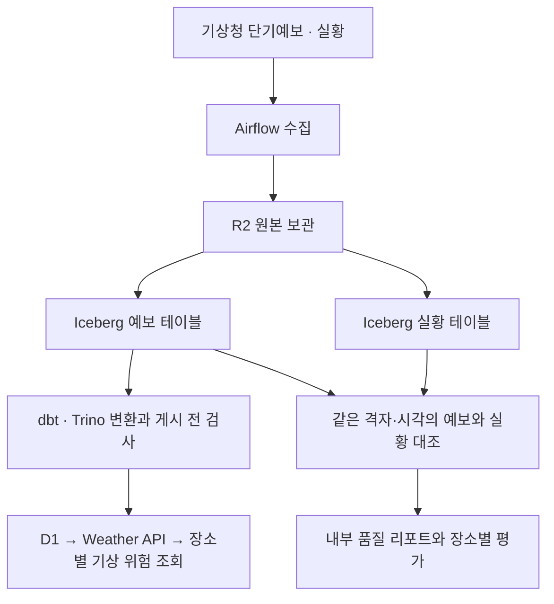

# ASK Seoul · 서울의 날씨와 교통을 함께 조회하기

기업 연계 팀 프로젝트에서 기상청 예보와 서울교통정보센터(TOPIS)의 교통 돌발 정보를 수집하고, 게시 전에 누락된 자료가 있는지 검사하는 일을 맡았습니다. 두 자료를 함께 조회할 수 있도록 시간은 한국 시간으로, 지역은 행정동 기준으로 맞췄습니다.

팀 프로젝트가 끝난 뒤 예보 수집을 이어가다 보니, 예약 작업이 성공해도 일부 발표가 빠진 날이 있었습니다. 수집기를 고친 뒤 **11월 18일 첫 예약 실행에서 누락 예보 두 회분을 다시 받았습니다.** 전날 23시와 당일 02시 예보였습니다. R2의 원본과 완료 기록을 맞춰 보니 두 발표 모두 서울 80개 격자의 자료가 들어왔습니다. [예약 실행 기록](https://github.com/masondev1024/seoul-weather-platform/actions/runs/44314324485) · [포트폴리오의 복구 기록](https://jungseongheon.org/portfolio/#ask-seoul-recovery)

## 맡은 범위

**팀 프로젝트에서 고친 적재 문제.** 한 번에 예보 8만 행 이상을 SQL 한 문장에 넣으려다 Trino의 쿼리 크기 제한에 걸렸습니다. 7월 3일부터 7일까지 정기 작업이 20번 실패했습니다. 예보는 나눠 읽고, 같은 실행에서 저장한 행을 지우고 새 행을 넣는 작업은 PyIceberg 트랜잭션 하나로 묶었습니다. 중간에 끊겨도 일부만 바뀐 상태가 남지 않습니다. 7월 8일 이후 팀이 확인한 실행에서는 같은 오류가 다시 나오지 않았습니다. [적재 변경 PR #178](https://github.com/ASAC-DE-bigkk/ASAC-DAG/pull/178) · [팀 설계 기록](https://github.com/ASAC-DE-bigkk/ASK-Seoul/blob/ba162272133c416da36ab4d07d35e25ffbff0c6e/engineering-decision-log.md)

교통 돌발 정보는 5분마다 수집할 때 dbt 변환 전체가 돌고 있었습니다. 팀에서는 수집 주기를 유지하고 변환만 한 시간에 한 번으로 바꿨습니다. 이때 하루 288회에서 24회로 줄어든 것은 dbt 실행 횟수입니다. [팀 실행 기록](https://jungseongheon.org/portfolio/#ask-seoul)

**개인 후속 작업.** 날씨 쪽에서는 빠진 예보를 보충하는 일 외에도, 어제 발표한 예보가 실제 관측값과 얼마나 달랐는지 확인하는 기능을 만들었습니다. 외부에서 장소별 기상 위험 시간대를 조회할 수 있도록 K-Skill에도 조회 기능 하나를 기여했습니다. [품질 평가 설계](docs/architecture/weather-forecast-quality.md) · [K-Skill 기여 PR #552](https://github.com/NomaDamas/k-skill/pull/552) · [ASK Seoul 팀 서비스](https://ask-seoul.kr/)

## 확인한 결과

기상청은 하루 여덟 번 단기예보를 발표합니다. 발표 때마다 서울 80개 격자를 받기로 했으므로, 하루 수집 기준은 **발표 시각과 격자의 조합 640개**입니다. 날짜별로 다음 날 오전 9시 17분(한국 시간)까지 저장된 조합을 셉니다.

예를 들어 11월 17일 예보는 18일 오전 9시 17분까지 400개가 들어왔습니다. 17일 23시 예보는 18일 밤 예약 실행에서 복구됐으므로 17일의 마감 기록은 400/640으로 남습니다. 나중에 다시 받은 양도 확인하면서, 제시간에 얼마나 들어왔는지 따로 볼 수 있습니다. [수집 누락 조사와 날짜별 집계](docs/operations/weather-coverage-20261117.md) · [보충 수집을 반영한 PR #110](https://github.com/masondev1024/seoul-weather-platform/pull/110)

## 구조 요약

로컬 Docker Compose에서 Airflow가 수집을 조율하고, dbt와 Trino로 예보를 가공합니다. 개인용 GitHub Actions 예약 수집기는 별도로 기상청 예보 원본을 R2에 저장합니다. [환경별 관리 범위](docs/architecture/platform-boundaries.md) · [예약 수집 워크플로](.github/workflows/weather-collection.yml)

### 데이터 처리 흐름



공개 API에는 예보로 만든 제품 4종을 게시합니다. 내부 품질 평가는 과거 예보와 그 시각의 실제 관측값을 함께 읽습니다. 두 작업은 같은 Trino를 쓰므로 쿼리 수와 실행 시간을 제한합니다.

## 주요 구현

### 1. 원본 보존과 재실행 가능한 수집

R2에 API 응답과 함께 수집 시각, 요청 결과, 원본 경로와 해시를 남깁니다. 실황을 받을 때는 80개 격자에 필수 항목과 기준 시각이 모두 있는지 확인합니다. 예보와 실황은 호출 예산을 공유하며, 재시도할 때 쓴 호출도 횟수에 넣습니다. [실황 수집 DAG](dags/domains/weather/weather_ultra_srt_ncst_bronze.py) · [실황 입력 기준](docs/architecture/kma-observation-truth.md) · [원본 수집과 Bronze 적재](dags/domains/weather/weather_ingest)

### 2. 외부 읽기와 메모리 사용 제한

수집 직후에 같은 원본을 R2에서 한 번 더 받는 일을 줄이려고 Bronze 적재에는 로컬 임시 파일을 재사용합니다. 해시가 다르거나 파일이 사라졌으면 R2 원본을 읽어 다시 검사합니다. 어떤 변경이 비용에 영향을 줬는지 볼 때는 Trino가 읽은 바이트, R2 요청 횟수, 캐시에서 읽은 양과 쿼리 대기 시간을 따로 기록합니다. [원본 재사용 코드](dags/domains/weather/weather_ingest/raw_spool.py) · [원격 읽기 회귀 테스트](dags/domains/weather/tests/test_weather_raw_transfer_budget.py) · [측정 기준](docs/operations/weather-trino-read-measurement.md)

### 3. 수집 장애의 복구 계획

GitHub Actions는 최신 발표를 수집하고, 이어서 24시간 안에 빠진 발표를 오래된 순서로 최대 두 회분까지 실제로 받습니다. 두 발표를 차례로 처리하며 일일 기상청 호출 한도 2,400회를 공유합니다. [예약 수집 코드](.github/workflows/weather-collection.yml) · [보충 한도와 되돌리는 기준](docs/operations/weather-coverage-20261117.md)

Airflow 쪽 복구 DAG는 담당하는 일이 다릅니다. 실행 기록을 읽어 검증된 원본으로 재처리할 수 있는 건(`RAW_REPLAY`), API에서 다시 받아야 할 건(`RECOLLECT`), 보류할 건(`DEFERRED`), 근거가 부족해 막을 건(`BLOCKED`)을 나눠 **복구 계획**을 남깁니다. 기본 계획 범위는 최근 24시간, 한 번에 최대 3건이며 그중 API 재수집 후보는 1건까지입니다. [복구 계획 DAG](dags/domains/weather/weather_recovery_coordinator.py) · [판단 로직](dags/common/recovery/planner.py)

### 4. 예보 시점을 보존하는 품질 평가

내일 비가 올 확률을 평가하려면, 비가 온 뒤에 수정된 예보가 섞이지 않아야 합니다. 그래서 평가마다 실행 ID(`evaluation_run_id`)와 기준 시각(`evaluation_as_of`)을 남깁니다. 관측 시각보다 1·2·3일 앞서 발표된 예보를 골라 기온 오차, 강수 확률의 Brier 점수, 강수 형태 정확도와 비교 가능한 표본 수를 구합니다. 예보나 관측값이 빠진 곳은 결측으로, 잠정 관측값으로 계산한 결과는 잠정 상태로 남깁니다.

계산과 검사를 마친 결과에만 `SUCCESS` 완료 기록을 붙입니다. 최신 리포트는 이 기록을 보고 결과를 고릅니다. [품질 모델](dbt/domains/traffic_weather/models/weather/quality) · [평가 결과 테이블](docs/architecture/forecast-quality-gold.md) · [리포트 생성 코드](tools/forecast_quality_report.py)

### 5. 장소별 품질 결과와 공개 제품 보호

장소별 평가에는 기존 장소·격자 매핑을 사용합니다. 연결된 지표가 없는 장소는 `NO_METRICS`로 남겨 어디가 비었는지 볼 수 있습니다. 공개 제품은 D1에 올리기 전에 데이터 계약, 행 수, 최신성을 검사합니다. 검사를 통과해야 이전 정상 결과를 교체합니다. [장소별 평가 설계](docs/architecture/forecast-quality-spatial-product.md) · [조인 코드](tools/spatial_quality_product.py) · [조인 테스트](tests/forecast_quality/test_spatial_product.py) · [게시 계약](dags/common/serving)

## 운영 중 확인한 문제와 설계 변경

8월 23일에는 Iceberg 유지보수가 하나뿐인 Trino 작업 슬롯을 약 10시간 점유했습니다. 뒤따르던 수집과 게시가 밀렸고, 오래된 결과는 게시 전 최신성 검사에서 걸렸습니다. 이후 유지보수의 기본 예약을 해제하고 작업 시간과 우선순위를 조정했습니다.

같은 기간에 오래 걸린 dbt 작업의 결과를 Airflow에 보고할 때 내부 API 토큰 만료로 403이 발생해 해당 토큰 설정을 수정했습니다. R2에 원본과 체크포인트를 쓰다가 DNS 오류로 멈춘 건은 중복 쓰기를 방지할 수 있는 조건에서만 재시도하도록 했습니다. 인증 오류나 데이터 형식 오류는 원인을 바로 확인하도록 남깁니다. [설계 변경 기록](docs/data-engineering-decision.md) · [장애 경과](docs/lessonrun.md)

## 공개 제품과 평가 대상

| 조회할 수 있는 내용 | 제품 식별자 |
|---|---|
| 장소별 현재 예보 | `weather_place_current_outlook` |
| 비가 올 것으로 예상되는 시간대 | `weather_place_precipitation_window` |
| 장소별 기상 위험 예상 시간대 | `weather_place_risk_window` |
| 같은 날짜의 최신 예보와 직전 예보 간 변화 | `weather_place_forecast_change_daily` |

80개는 날씨를 수집하고 평가하는 **기상 격자 수**, 427개는 기존 조회 방식과 호환되는 **장소 목록의 크기**입니다. K-Skill의 `seoul-weather-risk`가 제공하는 제품은 표의 `weather_place_risk_window`입니다. 개인 프록시는 Weather API의 허용된 세 경로에만 연결합니다. 개인 프록시 주소는 `KSKILL_PROXY_BASE_URL`로 지정하며 서비스 토큰은 Worker의 비밀값으로 보관합니다. [프록시 설정](k-skill-proxy/README.md) · [K-Skill 실행 코드](https://github.com/NomaDamas/k-skill)

## 저장소 구성

| 경로 | 내용 |
|---|---|
| [dags](dags) · [dbt](dbt/domains/traffic_weather) | 기상 수집·적재·게시 DAG, 변환 모델과 검사 |
| [weather_quality](weather_quality) · [contracts](contracts) | 예보·실황 평가 로직, 데이터 계약과 검증용 자료 |
| [release/weather](release/weather) · [k-skill-proxy](k-skill-proxy) | K-Skill 장소 목록 생성, 개인 Weather API 연결 |
| [tools](tools) · [tests](tests) | 수집·복구·리포트 도구, 계약과 회귀 테스트 |
| [provenance](provenance) · [docs](docs) | 이관한 파일의 출처와 체크섬, 설계·운영 기록 |

## 검증 방법

### 운영 자원에 접근하지 않는 기본 검증

저장소 루트에서 Python 3.11 가상환경을 활성화한 뒤 실행합니다. 아래 명령은 로컬 입력과 합성 격자 자료로 검사합니다. 실제 예보의 수집 상태는 발표 시각별 원본과 완료 기록을 대조합니다. [고정 도구 버전](runtime/toolchain.lock.json)

```bash
python -m pip install pytest==9.0.3 jsonschema==4.26.0 PyYAML==6.0.2 boto3==1.43.0 requests==2.32.5

python -m tools.repository_policy --repo-root .
python -m tools.verify_provenance --repo-root .
python -m tools.refresh_provenance --repo-root . --check
python -m tools.workflow_policy --repo-root .

python -m pytest tests/repository tests/deploy \
  tests/forecast_quality tests/contracts release/weather/tests -q
python -m pytest tests/tools/test_weather_collect_hosted.py \
  tests/tools/test_weather_daily_quality*.py tests/tools/test_weather_coverage_comparison.py -q
```

PowerShell에서는 다음 명령으로 정책·출처 검사와 `tests/repository`, `tests/deploy` 테스트를 실행할 수 있습니다. 예보 품질과 제품 검사는 위의 pytest 명령에 포함돼 있습니다. [검증 스크립트](tools/verify_repository.ps1)

```powershell
pwsh -NoProfile -File tools/verify_repository.ps1 -PythonExecutable python
```

### CI에서 추가로 확인하는 항목

CI는 고정한 dbt 버전으로 모델 구문과 공개 제품 계약을 검사합니다. Airflow DAG·프록시의 회귀 테스트도 실행하고, `main`으로 반영할 때에는 PR의 출발 브랜치를 확인합니다. 고정 Airflow 이미지에서 DAG를 불러오는 검사는 별도 도구로 실행합니다. [CI 설정](.github/workflows/ci.yml) · [dbt 의존성](runtime/requirements-dbt.lock.txt) · [DAG 불러오기 검사](tools/verify_dagbag.ps1)

## 로컬 운영과 배포 기준

로컬에서는 공통 `docker-compose.yml`에 `docker-compose.local.yml`을 함께 적용합니다. 예시 환경 파일에는 실황 수집 주기가 비어 있고 공유 호출 제한이 꺼져 있습니다. 로컬 설정은 공유 호출 제한을 켜고 실황을 매시 45분에 수집하도록 설정합니다. 이미 등록된 DAG의 활성 상태는 Airflow에서 확인합니다. [로컬 실행 방법](README-LOCAL.md) · [로컬 설정](docker-compose.local.yml) · [Trino 동시 실행 제한](trino/resource-groups.json)

예보 품질 DAG에는 기본 예약 시각이 없습니다. 이 DAG는 Weather 작업 풀의 두 슬롯을 모두 쓰고, 작업 하나는 15분, DAG 전체는 45분으로 제한합니다. [품질 DAG 설정](dags/domains/weather/weather_quality_dag_factory.py) · [품질 평가 운영 절차](docs/operations/weather-forecast-quality-runbook.md)

서비스 재시작, DAG 활성화·수동 실행, 과거 자료 재처리에 앞서 반영할 커밋, 실행 중인 작업, 읽고 쓸 R2·Iceberg·Trino·D1 대상과 복구 순서를 확인하고 운영 승인을 받습니다. [운영 자원 목록](docs/operations/current-resource-dependencies.md) · [배포 전 확인 사항](docs/operations/predeployment-approval-gate.md) · [실황 수집 활성화 절차](docs/operations/kma-observation-predeployment-plan.md)

## 설계와 구현 근거

팀 코드는 출처 목록에 고정한 커밋에서 가져왔습니다. 이관한 파일을 고치면 목록과 체크섬을 함께 갱신합니다. [원본 커밋](provenance/source-refs.lock.json) · [파일 목록](provenance/source-inventory.json) · [파일별 출처와 체크섬](provenance/source-files.jsonl) · [NOTICE](NOTICE)

제품 이름과 저장소 분리 과정, 초기 품질 리포트의 재처리 기준도 기록해 두었습니다. [용어와 제품 범위](CONTEXT.md) · [저장소 분리 설계](docs/superpowers/specs/2026-08-14-weather-repository-separation-design.md) · [초기 품질 리포트와 재처리](docs/runbooks/WEATHER_FORECAST_QUALITY_RUNBOOK.md)

## 변경 반영 절차

기능과 문서는 `feat/` 브랜치에서 `dev` 대상 PR로 검토합니다. 필수 CI와 검토를 통과한 `dev` 변경을 별도 PR로 `main`에 반영합니다. `dev`는 선형 이력을 유지하므로 두 브랜치의 실제 파일 차이는 `git diff origin/main origin/dev`로 확인합니다.
